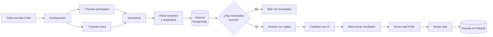

[README.md](https://github.com/user-attachments/files/34241665/README.md)
# Resumen diario de novedades con IA

Workflow de **n8n** que todas las mañanas lee 14 fuentes de noticias, descarta lo repetido y lo irrelevante, usa IA para clasificar lo que queda según un perfil de intereses y manda un resumen por mail.

<!-- Reemplazar esta línea por el video: en el editor web de GitHub, arrastrar demo.mp4 acá -->

## Qué resuelve

Seguir novedades de herramientas y del sector implica revisar blogs, foros y releases todos los días, y la mayoría de lo que aparece no sirve. Este flujo hace esa revisión de forma automática y entrega solo lo que vale la pena leer, con una frase que explica por qué.

## Cómo funciona



1. **Recolección.** Lee en paralelo 14 fuentes RSS: 7 principales (releases de n8n y Claude Code, blog y foro de n8n, OpenAI, Google AI, Product Hunt) y 7 de interés general (Hacker News, Hugging Face, MIT Technology Review, entre otras).
2. **Normalización.** Lleva todas las fuentes a un mismo formato: fuente, título, link, fecha y resumen.
3. **Filtro.** Descarta lo publicado hace más de unos días, los títulos repetidos y lo que ya se evaluó en los últimos 7 días, según el historial guardado en PostgreSQL.
4. **Puntaje por reglas.** Ordena con reglas simples (palabras clave, cambios de precios o deprecaciones, señales de publicidad) y limita la cantidad por fuente. Al modelo llegan como máximo 20 noticias.
5. **Clasificación con IA.** Una sola llamada a OpenAI clasifica cada noticia en *para revisar*, *idea*, *tendencia*, *competencia* o *irrelevante*, y escribe una frase sobre por qué importa. La respuesta llega en JSON.
6. **Entrega.** Arma un mail en HTML agrupado por secciones y lo envía por Gmail.
7. **Registro.** Guarda en el historial todo lo evaluado, enviado o descartado, para no repetirlo.

## Decisiones de diseño

- **Reglas antes que IA.** Filtrar y puntuar con código antes de llamar al modelo reduce el costo a una llamada por día y hace el resultado más predecible. La IA se usa solo donde aporta: entender el contenido y explicarlo.
- **Historial en base de datos.** Sin memoria, el mismo artículo aparecería varios días seguidos. La tabla guarda lo enviado y también lo descartado.
- **Tolerancia a fallas.** Si una fuente RSS no responde, el flujo sigue con las demás. Las fuentes más inestables tienen reintentos automáticos.
- **Validación de la respuesta de la IA.** Si el modelo no devuelve un JSON válido, el flujo no se rompe: manda un mail avisando del problema, con la respuesta recibida.
- **Configuración sin tocar código.** Destinatario, perfil de intereses, palabras clave y cantidades se editan en un solo nodo. El prompt lee el perfil desde ahí, así que el mismo flujo sirve para cualquier persona o tema.
- **Permisos mínimos en la base.** El usuario de PostgreSQL que usa n8n solo puede leer, insertar y actualizar esa tabla. No puede crear ni borrar tablas.

**Comportamiento conocido:** cada ejecución evalúa como máximo 20 noticias. Las que quedan fuera del corte no se registran, así que pueden aparecer en la ejecución siguiente si siguen siendo recientes. Con una ejecución diaria es lo buscado: una buena noticia que no entró hoy puede entrar mañana.

## Configuración

Todo se ajusta en el nodo **Configuración**:

| Campo | Para qué sirve |
| --- | --- |
| `destinatario` | Mail que recibe el resumen |
| `perfil` | Texto libre que describe a quién va dirigido: qué hace, qué le interesa y qué no. La IA lo usa para clasificar |
| `palabras_que_suman` | Palabras separadas por coma que suben el puntaje de una noticia |
| `palabras_que_restan` | Palabras separadas por coma que la descartan |
| `dias_hacia_atras` | Antigüedad máxima de las noticias |
| `max_principales` | Cantidad máxima de noticias principales en el mail |
| `max_extra` | Cantidad máxima de noticias de interés general |

Las fuentes se cambian agregando o quitando nodos RSS.

## Instalación

**Requisitos:** n8n (probado en la versión 2.43), una base PostgreSQL, una API key de OpenAI y una cuenta de Gmail.

1. **Crear la tabla** ejecutando [`schema.sql`](schema.sql) con un usuario que tenga permiso para crear tablas. Si n8n se conecta con otro usuario, darle permisos sobre la tabla:
   ```sql
   GRANT SELECT, INSERT, UPDATE ON novedades_vistas TO usuario_de_n8n;
   ```
2. **Importar el workflow:** en n8n, *Import from File* y elegir [`resumen-novedades-ia.json`](resumen-novedades-ia.json).
3. **Conectar las credenciales** en los nodos *Clasificar con IA* (OpenAI), *Enviar mail* (Gmail), *Leer historial* y *Guardar en historial* (PostgreSQL).
4. **Completar el nodo Configuración** con tu mail y tu perfil.
5. **Probar** con *Execute workflow* y, si el mail llega bien, activar el workflow.

## Archivos

| Archivo | Contenido |
| --- | --- |
| `resumen-novedades-ia.json` | El workflow para importar en n8n |
| `schema.sql` | Tabla del historial |
| `demo.mp4` | Video del flujo en ejecución |

## Tecnologías

n8n · OpenAI (gpt-4.1-mini) · PostgreSQL · Gmail · RSS

---

Hecho por **Juan Manuel Parisi** · [LinkedIn](https://www.linkedin.com/in/juan-manuel-parisi-b26a111b2/)
